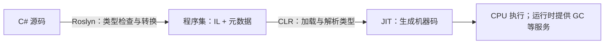

# 12 · 编译、运行时与类型系统

**目标：** 用代码分清编译器和运行时各决定什么：IL 与元数据、静态绑定与虚调用、泛型类型身份。

## 可运行入口

以下片段来自 [RuntimeLesson.cs](../samples/RuntimeLab/RuntimeLesson.cs)，定义和调用都在同一文件。在仓库根目录运行：

```sh
dotnet run --project samples/RuntimeLab -- 12
```

## 从源码到 IL，再到机器码

先定义一个可以反射的方法：

<!-- source: samples/RuntimeLab/RuntimeLesson.cs -->
```csharp
public static int Add(int left, int right) => left + right;
```

`Run()` 读取它所在的程序集和方法体：

<!-- source: samples/RuntimeLab/RuntimeLesson.cs -->
```csharp
var type = typeof(RuntimeLesson);
Console.WriteLine($"assembly={type.Assembly.GetName().Name}");
var method = type.GetMethod(nameof(Add))!;
Console.WriteLine($"method IL={method.GetMethodBody()?.GetILAsByteArray() is { Length: > 0 }}");
```

```text
assembly=RuntimeLab
method IL=True
```

`dotnet build` 调用 Roslyn，把方法体编译成 IL，把类型、成员和引用信息写入元数据。本项目的 `RuntimeLab.dll` 保存这些内容；CPU 不能直接执行 IL。反射通过元数据找到 `Add`，再读取其 IL。



默认执行路径中，JIT 按需生成当前平台的机器码；分层编译还可重新优化热点。内联、去虚化等优化不能改变可观察的语义。上面的输出只能证明存在 IL，不能证明实际机器码是否内联。

Native AOT 在发布时生成本机代码，执行时不依赖 JIT，仍需要 GC 等运行时服务，反射和动态代码生成也有额外限制。本实验针对默认构建，不用于验收 Native AOT。`dotnet run` 包含构建和启动，不能直接拿整条命令的耗时代表方法执行成本。

## 静态类型选成员，实际类型决定虚调用

同一个名字可以是隐藏成员，也可以是覆盖实现：

<!-- source: samples/RuntimeLab/RuntimeLesson.cs -->
```csharp
private class Worker
{
    public string Kind() => "worker";
    public virtual string Describe() => "worker";
}

private sealed class Engineer : Worker
{
    public new string Kind() => "engineer";
    public override string Describe() => "engineer";
}
```

通过基类引用调用：

<!-- source: samples/RuntimeLab/RuntimeLesson.cs -->
```csharp
Worker view = new Engineer();
Console.WriteLine($"declared={typeof(Worker).Name}; actual={view.GetType().Name}");
// Exercise 12: change only the receiver of Kind().
Console.WriteLine($"hidden={view.Kind()}; virtual={view.Describe()}");
```

```text
declared=Worker; actual=Engineer
hidden=worker; virtual=engineer
```

`view` 的静态类型是 `Worker`，所以非虚调用选中 `Worker.Kind`；`Describe` 是虚成员，再按对象的实际类型调用 `Engineer.Describe`。`new` 只隐藏成员，不会把它变成虚方法。强转为 `Engineer` 可改变 `Kind()` 的成员选择，却没有复制或替换对象。

普通静态类型表达式的成员查找、参数检查和重载解析发生在编译期；反射的存在不意味着普通 C# 调用采用 Python 式动态查找。JIT 即使优化掉虚调用，上述结果仍须相同。

## 泛型参数保留在运行时类型中

<!-- source: samples/RuntimeLab/RuntimeLesson.cs -->
```csharp
Console.WriteLine($"generic types differ={typeof(List<int>) != typeof(List<string>)}");
Console.WriteLine($"same definition={typeof(List<int>).GetGenericTypeDefinition() == typeof(List<string>).GetGenericTypeDefinition()}");
Console.WriteLine($"nullable wraps int={Nullable.GetUnderlyingType(typeof(int?)) == typeof(int)}");
```

```text
generic types differ=True
same definition=True
nullable wraps int=True
```

`List<int>` 与 `List<string>` 是不同类型，共用泛型定义 `List<>`。CLR 可以共享部分泛型机器码，尤其是引用类型实例化；共享代码不等于类型相同。`List<int>` 的元素无需先装箱为 `object`。与 C++ 模板不同，泛型方法体只能依赖声明的约束，不能等某个调用点再决定是否合法。

`int?` 是 `Nullable<int>`，具有不同的值类型表示；`string?` 则是可空分析注解，不会产生另一种 CLR 类型。编译器可空分析、运行时类型检查和 GC 管理各有职责。

## 迁移误区

- 从 C++ 迁移：基类变量保存派生对象的引用，不发生对象切片；方法默认非虚，需明确 `virtual` / `override`。
- 从 Python 迁移：`var` 是编译时类型推断；实际对象有更多方法，不代表静态类型允许调用它们。
- 把所有机制归给 GC：GC 管对象存活，不负责重载解析、泛型约束或可空警告。

## 练习与验收

可选练习：在 `RuntimeLesson.Run()` 的 `// Exercise 12` 后，只把 `view.Kind()` 改为 `((Engineer)view).Kind()`，保留 `view.Describe()` 和其他代码。重新运行上面的命令。

通过条件：退出码为 `0`；忽略章节标题，第四行变为 `hidden=engineer; virtual=engineer`；其余六行不变。这个修改改变了接收者表达式的静态类型，没有改变对象的实际类型。[参考答案](../exercises/solutions.md#12--编译与类型系统)

依据：[托管执行流程](https://learn.microsoft.com/en-us/dotnet/standard/managed-execution-process)、[元数据](https://learn.microsoft.com/en-us/dotnet/standard/metadata-and-self-describing-components)、[分层编译](https://learn.microsoft.com/en-us/dotnet/core/runtime-config/compilation)、[Native AOT](https://learn.microsoft.com/en-us/dotnet/core/deploying/native-aot/)、[多态](https://learn.microsoft.com/en-us/dotnet/csharp/fundamentals/object-oriented/polymorphism)、[运行时泛型](https://learn.microsoft.com/en-us/dotnet/csharp/programming-guide/generics/generics-in-the-run-time)。下一章：[内存与 GC](13-memory.md)。
