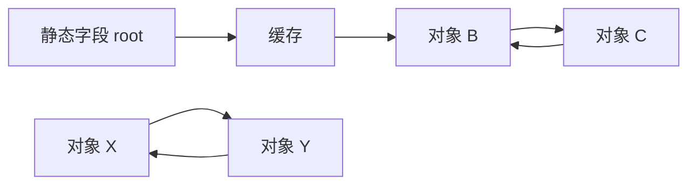

# 13 · 内存、对象图与 GC

**目标：** 用复制、装箱和保活实验区分值语义、物理存储与资源释放。

## 可运行入口

以下定义和调用来自 [MemoryLesson.cs](../samples/RuntimeLab/MemoryLesson.cs)，输入固定，无需文件或标准输入。在仓库根目录运行：

```sh
dotnet run --project samples/RuntimeLab -c Release -- 13
```

## struct 复制数据，也复制其中的引用

这个结构体同时持有一个整数和一个列表引用：

<!-- source: samples/RuntimeLab/MemoryLesson.cs -->
```csharp
private struct Reading(int value, List<int> tags)
{
    public int Value = value;
    public List<int> Tags = tags;
}
```

把数组元素复制到局部变量，分别修改两个字段：

<!-- source: samples/RuntimeLab/MemoryLesson.cs -->
```csharp
Reading[] readings = [new Reading(1, [10])];
var copy = readings[0];
copy.Value = 9;
copy.Tags.Add(20); // 复制 struct 时，Tags 复制的是 List 引用。
Console.WriteLine($"array={readings[0].Value}; copy={copy.Value}; shared tags={readings[0].Tags.Count}");
```

```text
array=1; copy=9; shared tags=2
```

`Value` 各有一份，`Tags` 则是两份引用指向同一列表。`Reading[]` 本身是引用类型，但元素内联保存 `Reading` 数据，不会把每个元素单独装箱。class 的 struct 字段同样内联在所属对象中。

**值 / 引用描述复制语义，栈 / 堆描述存储方式。** 局部值可能在栈、寄存器中，被闭包捕获成生成对象的字段，或被优化掉；`new Reading(...)` 不等于分配独立堆对象。[值类型](https://learn.microsoft.com/en-us/dotnet/csharp/language-reference/builtin-types/value-types)。

## 装箱保存当时的值副本

继续对同一数组操作：

<!-- source: samples/RuntimeLab/MemoryLesson.cs -->
```csharp
object boxed = readings[0]; // 装箱保存此时的 struct 副本。
readings[0].Value = 7;
// Exercise 13: 在这里更新箱内快照的 Value，保留下面的输出表达式。
Console.WriteLine($"array={readings[0].Value}; boxed={((Reading)boxed).Value}");
```

```text
array=7; boxed=1
```

装箱把当时的 `Reading` 副本放进对象；修改数组中的整数不改变箱内整数。`(Reading)boxed` 又取出一个值副本。注意这仍是浅复制：箱内 `Tags` 与数组元素的 `Tags` 继续指向同一列表。[装箱与解箱](https://learn.microsoft.com/en-us/dotnet/csharp/programming-guide/types/boxing-and-unboxing)。

## GC 看可达性，不看是否循环引用

创建一个指向自己的节点：

<!-- source: samples/RuntimeLab/MemoryLesson.cs -->
```csharp
private sealed class Node
{
    public Node? Next { get; set; }
}
```

<!-- source: samples/RuntimeLab/MemoryLesson.cs -->
```csharp
var root = new Node();
root.Next = root;
var weak = new WeakReference<Node>(root);
GC.Collect(); // 仅用于机制演示，不是业务代码的常规清理策略。
Console.WriteLine($"rooted cycle alive={weak.TryGetTarget(out _)}");
GC.KeepAlive(root); // 保证强根一直有效到弱引用检查之后。
```

```text
rooted cycle alive=True
```

强根保活了节点，自环不是原因。`KeepAlive(root)` 保证引用活到弱引用检查之后；不能仅凭源码仍在花括号内就假设 JIT 会保留局部引用。弱引用本身不保活，成功读取后拿到的普通引用则可保活。[KeepAlive](https://learn.microsoft.com/en-us/dotnet/api/system.gc.keepalive?view=net-10.0)、[WeakReference](https://learn.microsoft.com/en-us/dotnet/api/system.weakreference-1?view=net-10.0)。

GC 从仍活跃的局部引用、静态引用、GC handles 等 roots 出发，沿对象字段中的引用追踪。没有任何根可达的一组对象，即使互相引用也可回收；反过来，GC 不知道缓存中的业务数据“已过期”。



假定没有其他根，B/C 必须保留，X/Y 可以回收。把一个局部变量设为 null 不会断开缓存等其他保留链。

## 分配、回收与分代的成本

CLR 通常在托管堆分配 class 实例和数组。小对象分配常走线程分配区，空间足够时推进分配指针；预算或空间不足可能触发 GC。回收先确定存活对象，再回收不可达空间；选择压缩时会搬移对象并更新托管引用。对象身份不等于固定地址，也不是每次 GC 都压缩整个堆。[GC 基础](https://learn.microsoft.com/en-us/dotnet/standard/garbage-collection/fundamentals)、[运行时设计](https://github.com/dotnet/runtime/blob/main/docs/design/coreclr/botr/garbage-collection.md)。

分代利用“许多对象很快死亡”：新小对象通常进入 Gen 0，经历回收仍存活时通常逐步晋升到 Gen 1、Gen 2。高频收集年轻代可避免反复扫描全部长寿命数据；写屏障记录老对象到年轻对象的引用，使年轻代回收仍能找到保留链。回收一代同时包含更年轻的代；代号不是存活秒数。[分代实现](https://github.com/dotnet/runtime/blob/main/docs/design/coreclr/botr/garbage-collection.md)。

因此分配成本还包括初始化、追踪和可能的搬移。大对象进入 LOH，随 Gen 2 回收，通常不压缩但并非永不移动；反复分配大缓冲区会增加成本。互操作中的 pinning 会限制搬移并可能增加碎片，固定时间应覆盖实际需要稳定地址的区间。[分代与 LOH](https://learn.microsoft.com/en-us/dotnet/standard/garbage-collection/fundamentals)、[固定与指针](https://learn.microsoft.com/en-us/dotnet/csharp/language-reference/unsafe-code)。

## GC 无法替你结束业务生命周期

排查“泄漏”先找保留链：静态字典可留住大缓冲区；长寿命发布者的事件委托可留住订阅者；未完成的异步操作可通过状态机留住跨 `await` 使用的数据。应分别限制缓存、取消订阅、结束操作，而不是反复 `GC.Collect()`。[事件订阅](https://learn.microsoft.com/en-us/dotnet/csharp/programming-guide/events/how-to-subscribe-to-and-unsubscribe-from-events)、[异步状态](14-execution-model.md)。

`Dispose` 是普通方法，`using` 安排其调用，解决文件或句柄何时释放；托管对象何时回收仍由 GC 决定。终结器是非确定性的兜底，不能替代 `using`。包装原生句柄优先使用 `SafeHandle`；仅持有托管对象一般无需终结器。具体清理代码见[下一章的 using](14-execution-model.md#属性与-using隐含的调用)。[Dispose 实现](https://learn.microsoft.com/en-us/dotnet/standard/garbage-collection/implementing-dispose)。

## 迁移误区

- 不按 C++ 析构或 CPython 常见引用计数释放时机推断 C# 对象寿命。
- 弱引用不是缓存容量策略；GC 也无法回收仍可达的数据。
- 先确认分配和保留来源，再选 struct、缓冲池或固定内存，不凭类型名推断成本。

## 练习与验收

可选练习：在 `MemoryLesson.Run()` 的 `// Exercise 13` 位置，将 `boxed` 解箱到一个 `Reading` 局部变量，把其 `Value` 改为 42，再将该值重新赋给 `boxed`。保留原来的两处赋值和全部输出表达式。

运行上述命令，退出码应为 0，输出应为：

```text
array=1; copy=9; shared tags=2
array=7; boxed=42
rooted cycle alive=True
```

验收边界：临时去掉“重新赋给 boxed”这一行，第二行应恢复 `array=7; boxed=1`；这证明修改的是解箱副本，重新装箱才让变量引用新的箱子。其余行不变，不以 GC 次数或不可达对象的回收时间作为通过条件。[参考答案](../exercises/solutions.md#13--解箱副本与重新装箱)

官方依据核对：2026-09-28。下一章：[执行机制](14-execution-model.md)。
